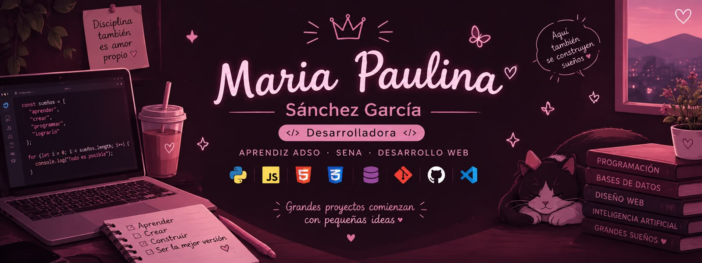

<!-- ═══════════════════════ ENCABEZADO ═══════════════════════ --> 
    

  

  

   

  

 
   <!-- ═══════════════════════ SOBRE MÍ ═══════════════════════ --> <h2 align="center">💡 Sobre mí</h2> 
  

🌸 Estudiante de Análisis y Desarrollo de Software (ADSO) con conocimientos en tecnologías web, bases de datos relacionales y control de versiones.

🤖 Me apasiona integrar inteligencia artificial y soluciones tecnológicas modernas en el diseño de interfaces y la lógica de programación.

🚀 Orientada al aprendizaje continuo, la resolución de problemas y el trabajo colaborativo, fortaleciendo cada día mis habilidades técnicas y mi experiencia práctica.

  

🎯 Enfoque	🌱 Aprendiendo	🤝 Me gusta
Desarrollo web y bases de datos	JavaScript, PostgreSQL y n8n	Trabajo en equipo y retos de lógica

   <!-- ═══════════════════════ CONTACTO ═══════════════════════ --> <h2 align="center">📞 Contacto</h2> 
          
   <!-- ═══════════════════════ EXPERIENCIA ═══════════════════════ --> <h2 align="center">💼 Experiencia</h2>
🌷 Desarrolladora de Software · Proyectos Académicos — SENA

2025 – Presente  ·  📍 Medellín, Colombia

🎨 Diseñé prototipos y wireframes para aplicaciones web con Penpot y MockFlow, organizando elementos visuales y la estructura de las interfaces.
💻 Desarrollé interfaces y ejercicios de lógica con JavaScript, Bootstrap 5.3, HTML y CSS.
🗄️ Trabajé con bases de datos relacionales usando PostgreSQL y pgAdmin, practicando consultas y gestión de información.
🔀 Usé Git y GitHub para el control de versiones, la organización del código y la colaboración en proyectos académicos.
  <!-- ═══════════════════════ FORMACIÓN ═══════════════════════ --> <h2 align="center">🎓 Formación académica</h2> 

🏫 Institución	📖 Programa	⏳ Estado
SENA — Servicio Nacional de Aprendizaje	Tecnología en Análisis y Desarrollo de Software (ADSO)	🌱 En curso
I.E. Débora Arango Pérez	Educación Secundaria	✅ Concluida

   <!-- ═══════════════════════ SKILLS ═══════════════════════ --> <h2 align="center">🛠️ Habilidades</h2> <h3 align="center">💻 Lenguajes y tecnologías web</h3> 
  
 <h3 align="center">🗄️ Bases de datos</h3> 
      
 <h3 align="center">⚙️ Herramientas y entornos</h3> 
       
 <h3 align="center">🎨 Diseño y prototipado UI/UX</h3> 
   
 <h3 align="center">🤖 IA y automatización</h3> 
      ✨ Uso la IA como apoyo al aprendizaje y al desarrollo de soluciones, y exploro la automatización de tareas. 
   

🌸 Habilidades blandas

Pensamiento lógico · Aprendizaje autónomo · Resolución de problemas · Trabajo en equipo · Creatividad · Responsabilidad · Adaptabilidad

🌎 Idiomas
  
   <!-- ═══════════════════════ CURSOS ═══════════════════════ --> <h2 align="center">📚 Cursos y formación continua</h2> 

📌 Curso	🏛️ Entidad	📅 Año
Desarrollo Web con JavaScript	AprendeJavaScript · Formación autónoma	2026
Bases de Datos con PostgreSQL y pgAdmin	SENA	2026
Actividades y Proyectos Comunitarios · Historial de Servicio	Politécnico de Antioquia	—

   <!-- ═══════════════════════ ESTADÍSTICAS ═══════════════════════ --> <h2 align="center">📊 Estadísticas de GitHub</h2> 
         
   <!-- ═══════════════════════ PIE ═══════════════════════ --> 

🌷 Gracias por visitar mi perfil

Aprendiendo, construyendo y mejorando cada día. 💗

  

